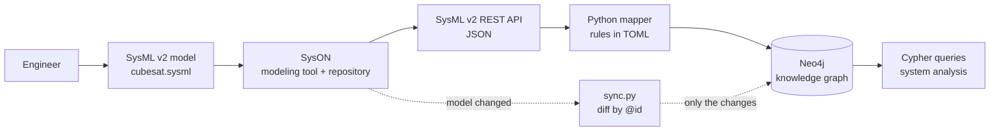
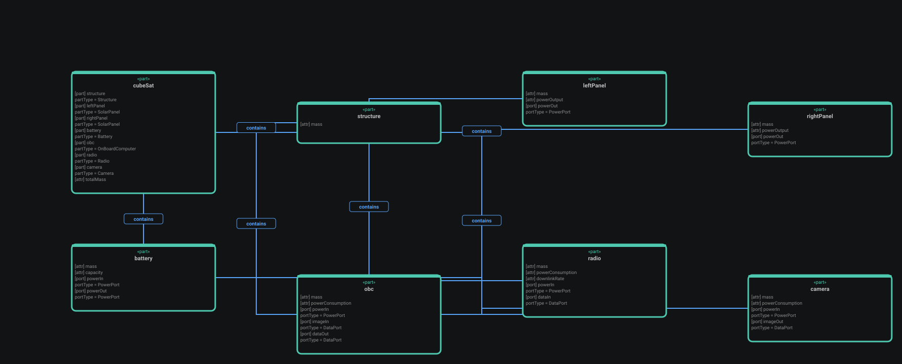

# SysML v2 → Knowledge Graph: dynamic mapping for system analysis

A small but complete prototype that turns a **SysML v2 model** into a **knowledge graph** and keeps the graph **in sync** when the model changes. The graph is then used for **system analysis**: requirement checks, gap detection and change-impact analysis.

The example system is a **3U CubeSat**. Everything runs locally with open-source tools.



---

## 1. What it does

| Step | Tool | Result |
|---|---|---|
| 1. Idea | – | CubeSat 3U: structure, 2 solar panels, battery, on-board computer (OBC), radio, camera |
| 2. Modeling tool | VS Code + SysML v2 extension, SysON | model written, validated (0 errors) and visualised |
| 3. SysML v2 model | [`model/cubesat.sysml`](model/cubesat.sysml) | parts, attributes with units, ports, connections, requirements, satisfy, verification cases, use case, activity, allocation, states, sequence |
| 4. SysML v2 API | SysON REST API | model as JSON: **1161 elements** |
| 5. Repository + versioning | SysON + PostgreSQL, own snapshots | `data/snapshots/` |
| 6. Mapper | [`mapper/sysml_to_graph.py`](mapper/sysml_to_graph.py) + [`mapper/mapping_rules.toml`](mapper/mapping_rules.toml) | **1161 elements → 65 nodes, 77 edges** |
| 7. Graph database | Neo4j 5 | property graph |
| 8. Analysis | [`queries/system_analysis.cypher`](queries/system_analysis.cypher) | mass check, gap detection, change impact |
| Dynamic | [`mapper/sync.py`](mapper/sync.py) | model edit → only the changed nodes/edges are written to Neo4j |

---

## 2. The example model

The SysML v2 model has 11 sections. Diagrams were exported from the VS Code SysML v2 extension.

| View | File |
|---|---|
| General view (parts, requirements, verification) | [`docs/diagrams/general_view.svg`](docs/diagrams/general_view.svg) |
| Interconnection (ports and connections) | [`docs/diagrams/interconnection_view.svg`](docs/diagrams/interconnection_view.svg) |
| Use case | [`docs/diagrams/case.svg`](docs/diagrams/case.svg) |
| Activity (imaging task) | [`docs/diagrams/activity.svg`](docs/diagrams/activity.svg) |
| States (safe / nominal / imaging mode) | [`docs/diagrams/state.svg`](docs/diagrams/state.svg) |
| Sequence (operator → ground station → satellite) | [`docs/diagrams/sequence.svg`](docs/diagrams/sequence.svg) |



**Requirements**

| ID | Requirement | Satisfied by | Verified by |
|---|---|---|---|
| R1 | Total mass ≤ 4 kg (constraint) | cubeSat | MassTest |
| R2 | Battery supplies OBC, radio and camera during a 45 min eclipse (constraint) | battery | EclipseDischargeTest |
| R3 | Take an Earth image and send it to the ground station | camera, radio | EndToEndDownlinkTest |
| R4 | Internal temperature between −20 and 60 °C | *nobody at first (intentional gap)* | ThermalVacuumTest |

---

## 3. Mapping rules (the core of the prototype)

The SysML v2 API returns 1161 elements. Most of them are internal "plumbing" (memberships, typings, expressions). The mapper uses five rules, configured in [`mapping_rules.toml`](mapper/mapping_rules.toml), so new rules need no code change:

| Rule | SysML v2 JSON | Knowledge graph | Example |
|---|---|---|---|
| 1. Element → node | `PartUsage`, `RequirementUsage`, `StateUsage`, … | node with label | `(:Part {name: "battery"})` |
| 2. Reference → edge | `definition`, `owner` | `TYPED_BY`, `PART_OF` | `battery -TYPED_BY-> Battery` |
| 3. Relationship element → edge | `SatisfyRequirementUsage`, `ConnectionUsage`, `AllocationUsage`, `TransitionUsage`, verify, `FlowUsage` | `SATISFIES`, `CONNECTED_TO`, `ALLOCATED_TO`, `TRANSITION`, `VERIFIES`, `MESSAGE` | `battery -SATISFIES-> r2_eclipsePower` |
| 4. Value → property | `AttributeUsage` → `FeatureValue` → `0.3 [kg]` | `mass: 0.3, mass_unit: "kg"` | on the battery node |
| 5. Plumbing → skipped | `OwningMembership`, `FeatureTyping`, … | – | only used to resolve rules 1–4 |

Two views are created for connections: the detailed view (`port -CONNECTED_TO-> port`) and a simplified analysis view (`battery -POWERS-> obc`, `obc -SENDS_DATA-> radio`).

Every node keeps its SysML `@id` (`sysml_id`). This is what makes the dynamic update possible.

---

## 4. System analysis results

All queries are in [`queries/system_analysis.cypher`](queries/system_analysis.cypher).

| Question | Answer from the graph |
|---|---|
| Q1. Total mass and requirement R1 | **2.2 kg ≤ 4.0 kg → PASS** |
| Q2. Which requirement is not satisfied by any part? | **r4_thermalRange** |
| Q3. Which parts depend on the battery? | **obc, radio, camera** |
| Q4. Which requirements are affected if the battery changes? | **r2** (via battery), **r3** (via camera, radio) |

Example (Q2, gap detection):

```cypher
MATCH (r:Requirement)
WHERE NOT EXISTS { ()-[:SATISFIES]->(r) }
RETURN r.name AS unsatisfied, r.doc AS text;
```

---

## 5. Dynamic mapping demo: closing the R4 gap

1. The graph reports the gap: **R4 (thermal) is not satisfied**.
2. The engineer adds a heater **inside SysON** (no re-import, so all existing `@id`s stay the same):
   ```sysml
   part def Heater { attribute mass : ISQ::MassValue; attribute powerConsumption : ISQ::PowerValue; port powerIn : ~PowerPort; }
   part heater : Heater { attribute :>> mass = 0.05 [SI::kg]; attribute :>> powerConsumption = 1.0 [SI::W]; }
   connect battery.powerOut to heater.powerIn;
   satisfy r4_thermalRange by cubeSat.heater;
   ```
3. `python3 mapper/sync.py --apply` compares the new graph with the last snapshot **by `@id`** and writes **only the changes** to Neo4j:
   ```
   Changes found: 9
     + node  Port         heater.powerIn
     + node  PartDef      Heater
     + node  Part         heater
     + edge  heater -SATISFIES-> r4_thermalRange
     + edge  battery.powerOut -CONNECTED_TO-> heater.powerIn
     + edge  battery -POWERS-> heater
     + edge  heater -PART_OF-> cubeSat
     + edge  heater -HAS_PORT-> heater.powerIn
     + edge  heater -TYPED_BY-> Heater
   Neo4j updated (only the changes above).
   ```
4. Q2 now returns **no records** (no unsatisfied requirement). Q1 returns **2.25 kg → PASS**.

`python3 mapper/sync.py --apply --watch 30` repeats this every 30 seconds.

---

## 6. Findings

1. **SysON keeps only one commit per project** (`"The one and only commit for this project"`). Versioning is therefore done by the mapper itself: snapshots in `data/snapshots/` and a diff by SysML `@id`.
2. **Ports are owned by the part definition.** `leftPanel.powerOut` and `rightPanel.powerOut` are the same `PortUsage` in the JSON (both come from `SolarPanel`). The mapper resolves feature chains and creates one port node per part instance.
3. **Units arrive only as standard-library `@id`s** (for example the id of `SI::kg`). The mapper translates them with a small unit table.
4. **Derived values in the model can become stale.** After adding the heater, the hand-written `totalMass` formula in the SysML model still sums only the old parts (2.2 kg). The graph query sums all parts connected by `PART_OF` and returns the correct 2.25 kg.
5. **Re-importing a `.sysml` file gives all elements new `@id`s.** Incremental (dynamic) updates need the model to be edited inside the tool.
6. **Tool limitation:** the sequence view of the VS Code extension does not read SysML v2 `message` elements, so [`sequence.svg`](docs/diagrams/sequence.svg) was generated from the model directly. The mapper does read the messages (`MESSAGE` edges).

## 7. Limitations and next steps

- Mapping rules cover the SysML v2 concepts used in this model; other concepts (variants, individuals, calculations, interfaces as definitions) need new rules.
- Constraint expressions (e.g. `totalMass <= massLimit`) are not yet translated into graph queries automatically; R1/R2 checks are written by hand in Cypher.
- Only a property graph (Neo4j) is generated. An RDF/OWL export with an ontology would allow semantic reasoning and data exchange with other tools.
- `sync.py` polls the API. With a tool that offers commits or change events, the diff could come directly from the repository.
- Evaluation on a larger, representative model (e.g. a real mission model) is the next step.

## 8. Related work

- F. Schummer and M. Hyba, *An approach for system analysis with model-based systems engineering and graph data engineering*, Data-Centric Engineering, 2022. [doi:10.1017/dce.2022.33](https://doi.org/10.1017/dce.2022.33), [arXiv:2201.06363](https://arxiv.org/abs/2201.06363). Transfers SysML (v1) models from MagicDraw to Neo4j and analyses the MOVE-II CubeSat.
  **Difference here:** SysML v2 via the standard REST API, configurable mapping rules, and incremental (dynamic) updates by `@id`.

---

## 9. How to run

Requirements: Docker, Docker Compose, Python 3.11+ (no extra Python packages).

```bash
# 1. SysON (modeling tool + repository + SysML v2 API) -> http://localhost:8080
cd infra/syson && docker compose up -d && cd ../..
#    create a blank project "CubeSat" and upload model/cubesat.sysml

# 2. read the model from the API
python3 mapper/fetch_model.py --project <PROJECT_ID>

# 3. map it to a graph
python3 mapper/sysml_to_graph.py            # -> data/graph.json, data/graph.cypher

# 4. Neo4j -> http://localhost:7474 (neo4j / cubesat123)
cd infra/neo4j && docker compose up -d
docker compose exec neo4j cypher-shell -u neo4j -p cubesat123 -f /import/graph.cypher
cd ../..

# 5. run the queries in queries/system_analysis.cypher (Neo4j Browser)

# 6. dynamic sync after editing the model in SysON
python3 mapper/sync.py --apply              # add --watch 30 to repeat
```

## 10. Repository structure

```
model/cubesat.sysml            SysML v2 model (11 sections)
docs/diagrams/                 exported diagrams (SVG)
infra/syson/                   SysON (Docker Compose)
infra/neo4j/                   Neo4j (Docker Compose)
mapper/fetch_model.py          SysML v2 API -> data/elements.json
mapper/mapping_rules.toml      mapping rules (configurable)
mapper/sysml_to_graph.py       elements -> graph (JSON + Cypher)
mapper/sync.py                 dynamic sync (diff by @id, incremental update)
queries/system_analysis.cypher analysis queries
data/                          generated files (elements, graph, snapshots)
```

